<p align="center">
  
</p>

# git-carpet

Weave a Persian carpet from your GitHub activity. The carpet is an SVG for your profile README, with a soft light that sweeps across the pile every few seconds, the way silk catches the light.

Every carpet keeps the symmetry of a [Persian](https://en.wikipedia.org/wiki/Persian_carpet) city rug ([Kashan](https://en.wikipedia.org/wiki/Persian_carpet#Town_carpets), [Tabriz](https://en.wikipedia.org/wiki/Tabriz_rug), [Isfahan](https://en.wikipedia.org/wiki/Isfahan_rug), [Nain](https://en.wikipedia.org/wiki/Nain_rug), [Heriz](https://en.wikipedia.org/wiki/Heriz_rug)). Only one quarter of the design is computed, and the rest is its mirror image left↔right and top↔bottom. A test checks this on every build.

## Gallery

The carpets below are woven from made-up profiles.

### Five city harmonies

Your top language and your login pick one of five palettes, each modeled on a weaving city. Kashan and Tabriz weave a herati lattice. Nain uses a finer lattice and a thinner border. Isfahan fills the field with palmettes on a vine. Heriz is geometric: a stepped medallion and a sparse grid of angular flowers.

<table>
  <tr>
    <td align="center"><br /><sub><b><a href="https://en.wikipedia.org/wiki/Persian_carpet#Town_carpets">Kashan</a></b><br />madder field, indigo border</sub></td>
    <td align="center"><br /><sub><b><a href="https://en.wikipedia.org/wiki/Tabriz_rug">Tabriz</a></b><br />ivory field, madder border</sub></td>
    <td align="center"><br /><sub><b><a href="https://en.wikipedia.org/wiki/Isfahan_rug">Isfahan</a></b><br />indigo field, palmette vine</sub></td>
    <td align="center"><br /><sub><b><a href="https://en.wikipedia.org/wiki/Nain_rug">Nain</a></b><br />ivory field, fine herati</sub></td>
    <td align="center"><br /><sub><b><a href="https://en.wikipedia.org/wiki/Heriz_rug">Heriz</a></b><br />pomegranate field, geometric</sub></td>
  </tr>
</table>

### Quiet to prolific

These three share a login, so they use the same palette, and only the activity differs.

<table>
  <tr>
    <td align="center"><br /><sub><b>Quiet</b><br />40 contributions · 3-day streak · 1-year-old account</sub></td>
    <td align="center"><br /><sub><b>Steady</b><br />600 contributions · 35-day streak · 7 years</sub></td>
    <td align="center"><br /><sub><b>Prolific</b><br />4,200 contributions · 120-day streak · 13 years</sub></td>
  </tr>
</table>

To re-weave the gallery after a design change, run `node examples/gallery.js`.

## Use it

Add this workflow to your profile repository (the one named after your username) as `.github/workflows/carpet.yml`:

```yaml
name: Carpet
on:
  schedule:
    - cron: "40 1 * * *"
  workflow_dispatch:
permissions:
  contents: write
jobs:
  weave:
    runs-on: ubuntu-latest
    steps:
      - uses: actions/checkout@v7
      - uses: AlirezaAzadbakht/git-carpet@v1
```

Run it once from the Actions tab, then show the carpet in your `README.md`:

```html

```

| Input | Default | |
|---|---|---|
| `user` | repository owner | Account whose carpet to weave |
| `output-dir` | `carpet` | Folder that receives `carpet.svg` |
| `commit` | `true` | Commit and push the SVG when it changes |
| `commit-message` | `carpet: weave the day's carpet` | |
| `github-token` | `${{ github.token }}` | The built-in token is enough; only public data is read |

## How your activity becomes a carpet

Activity changes the carpet a lot. A quiet year weaves a calm, open rug, and a busy one weaves a dense, gilded one.

| Part of the rug | Quiet profile | Busy profile | Comes from |
|---|---|---|---|
| Field ([matn](https://en.wikipedia.org/wiki/Persian_carpet#Field_design,_medallions_and_borders)) | Open ground with scattered flowers | Leaves, then the herati lattice, then florets, then Shah Abbasi palmettes on alternate nodes. Isfahan grows a palmette vine instead; Heriz keeps a sparse grid of angular flowers | Contributions in the last year |
| Central medallion ([toranj](https://en.wikipedia.org/wiki/Persian_carpet#Field_design,_medallions_and_borders)) | Small, plain star, with a thin cloud band in the halo | Large, with two petal rings, an inner lobed frame, pendants, and a gold cloud band around it. Heriz uses a stepped diamond | Contributions in the last year |
| Gold thread | None | Gold vine from a 30-day streak; gold rosettes and medallion band from 90 days | Longest daily streak |
| Main border ([hashiyeh](https://en.wikipedia.org/wiki/Persian_carpet#Field_design,_medallions_and_borders)) | A few rosettes | More rosettes, closer together | Longest daily streak |
| Outer frame | One guard and one stripe | Up to three stripes, plus a second interlocking-tooth guard after 8 years | Account age |
| Color harmony and city layout | | | Your top language and your login. Kashan and Tabriz are herati, Nain a finer herati with a thinner border, Isfahan a palmette field, Heriz geometric |
| [Abrash](https://en.wikipedia.org/wiki/Abrash): soft bands of shade | | | Each week of the last year, woven bottom to top. Busy weeks are a richer dye, quiet weeks a lighter one, the way real rugs show dye batches |

Every color is a natural dye: madder, indigo, ivory, saffron, walnut, pistachio, pomegranate. The same account on the same day always gives the same carpet.

## Locally

```bash
node src/cli.js <login>          # writes carpet/carpet.svg (uses `gh auth token` if present)
node src/cli.js --fixture test/fixtures/busy.json --out /tmp/rug
node test/check.js               # symmetry, determinism, size budget
```

There are no dependencies and no build step. Node 20 or newer is enough.

## References

- [Persian carpet](https://en.wikipedia.org/wiki/Persian_carpet), Wikipedia: the design vocabulary (field, medallion, corner pieces, borders) and the [town carpets](https://en.wikipedia.org/wiki/Persian_carpet#Town_carpets) of Kashan, Isfahan and Nain.
- [Tabriz rug](https://en.wikipedia.org/wiki/Tabriz_rug), [Isfahan rug](https://en.wikipedia.org/wiki/Isfahan_rug), [Nain rug](https://en.wikipedia.org/wiki/Nain_rug), [Heriz rug](https://en.wikipedia.org/wiki/Heriz_rug), Wikipedia: the five harmonies.
- [Abrash](https://en.wikipedia.org/wiki/Abrash), Wikipedia: the dye-batch shading the weekly bands imitate.

## License

MIT
